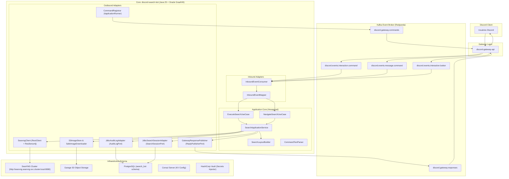
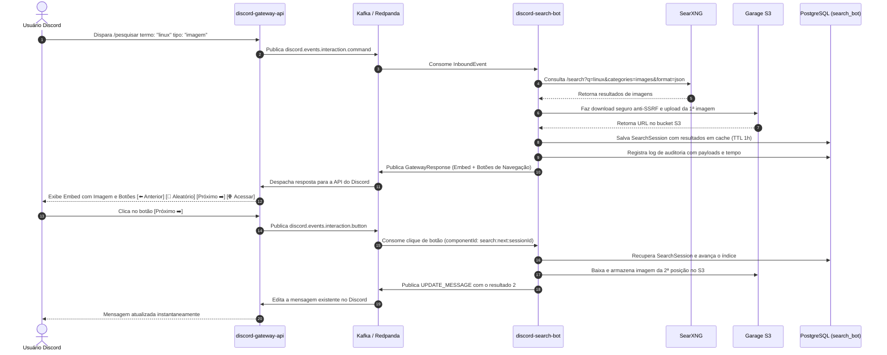

# 🔍 Discord Search Bot

[](https://openjdk.org/)
[-JDK%2025-red?logo=graalvm)](https://www.graalvm.org/)
[](https://spring.io/projects/spring-boot)
[](https://searxng.org/)
[](https://www.postgresql.org/)
[](https://kafka.apache.org/)
[](https://resilience4j.readme.io/)
[](https://garagehq.deuxfleurs.fr/)

O **Discord Search Bot** é um microsserviço corporativo de pesquisa na web e indexação multimídia orientado a eventos para comunidades no Discord. Desenvolvido sobre o **Java 25 com Oracle GraalVM (GFTC)** em compilação nativa (**Native Image**) e **Spring Boot 4**, ele adota os princípios de **Arquitetura Hexagonal (Ports and Adapters)**, operando de forma reativa e desacoplada via **Kafka / Redpanda**.

O bot integra o motor de metabusca privado **SearXNG**, permitindo aos usuários consultar a web geral, imagens, arquivos/documentos e notícias. Ele oferece download seguro com proteção anti-SSRF para upload de imagens em armazenamento **S3 (Garage)**, paginação dinâmica por botões interativos do Discord (Anterior, Próximo, Aleatório e Link direto), e trilha completa de auditoria persistida em **PostgreSQL**.

---

## 🏛️ Blueprint da Arquitetura

O bot opera de forma desacoplada do Discord: o **discord-gateway-api** consome os eventos da API do Discord e os publica em tópicos Kafka. O `discord-search-bot` consome os comandos `/pesquisar`, `.pesquisar` e as interações de botões, processa as buscas no SearXNG e publica as respostas prontas com embeds e botões de volta ao Gateway.



---

## ⚡ Fluxo de Execução e Paginação Interativa



---

## 📂 Estrutura Hexagonal do Projeto

```
src/
├── main/
│   ├── java/dev/gdinizds/discordsearchbot/
│   │   ├── DiscordSearchBotApplication.java
│   │   ├── domain/
│   │   │   ├── model/
│   │   │   │   ├── SearchType.java           # Enum (WEB, IMAGE, FILE, NEWS) e aliases
│   │   │   │   ├── SearchFilter.java         # Value Object para filtros e paginação
│   │   │   │   ├── SearchHit.java            # Resultado textual
│   │   │   │   ├── ImageHit.java             # Resultado de imagem com metadados e S3
│   │   │   │   ├── HitItem.java              # Item unificado de exibição
│   │   │   │   ├── SearchSession.java        # Sessão de busca com estado de navegação
│   │   │   │   ├── SearchCommand.java        # Comando de entrada de pesquisa
│   │   │   │   ├── NavigationCommand.java    # Comando de paginação por botões
│   │   │   │   ├── AuditLogEntry.java        # Registro imutável de auditoria
│   │   │   │   └── OutboundResponse.java     # Resposta para o Discord com Embeds e Botões
│   │   │   └── service/
│   │   │       ├── CommandTextParser.java    # Parser flexível de comandos .pesquisar
│   │   │       └── SearchLayoutBuilder.java  # Renderizador de Embeds e ActionRows
│   │   ├── application/
│   │   │   ├── port/
│   │   │   │   ├── in/
│   │   │   │   │   ├── ExecuteSearchUseCase.java
│   │   │   │   │   └── NavigateSearchUseCase.java
│   │   │   │   └── out/
│   │   │   │       ├── SearchEnginePort.java
│   │   │   │       ├── ImageStoragePort.java
│   │   │   │       ├── SearchSessionPort.java
│   │   │   │       ├── AuditLogPort.java
│   │   │   │       └── ReplyPublisherPort.java
│   │   │   └── service/
│   │   │       ├── SearchApplicationService.java
│   │   │       └── Mdc.java
│   │   ├── adapter/
│   │   │   ├── in/kafka/
│   │   │   │   ├── InboundEvent.java
│   │   │   │   ├── InboundEventMapper.java
│   │   │   │   └── InboundEventConsumer.java
│   │   │   └── out/
│   │   │       ├── searxng/SearxngClient.java
│   │   │       ├── s3/
│   │   │       │   ├── ImageFormat.java
│   │   │       │   ├── SafeImageDownloader.java
│   │   │       │   └── S3ImageStore.java
│   │   │       ├── persistence/
│   │   │       │   ├── JdbcAuditLogAdapter.java
│   │   │       │   └── JdbcSearchSessionAdapter.java
│   │   │       └── kafka/
│   │   │           ├── GatewayResponse.java
│   │   │           ├── GatewayResponsePublisher.java
│   │   │           └── CommandRegistrar.java
│   │   └── config/
│   │       ├── ApplicationConfig.java
│   │       ├── SearchBotProperties.java
│   │       ├── S3Config.java
│   │       ├── KafkaConfig.java
│   │       ├── ResilienceConfig.java
│   │       ├── Resilience.java
│   │       └── NativeRuntimeHints.java
│   └── resources/
│       ├── application.yaml
│       └── db/migration/
│           └── V1__init_schema.sql
└── test/
    └── java/dev/gdinizds/discordsearchbot/
        ├── ArchitectureTest.java             # ArchUnit validando fronteiras hexagonais
        ├── domain/
        ├── application/
        └── adapter/
```

---

## 🎯 Comandos Suportados

### 1. Slash Command: `/pesquisar`
Registrado automaticamente no Discord Gateway via `discord.gateway.commands`.

| Parâmetro | Tipo | Obrigatório | Descrição | Exemplo |
| :--- | :--- | :---: | :--- | :--- |
| `termo` | `STRING` | **Sim** | Termo ou expressão a ser pesquisada | `kubernetes tutorial` |
| `tipo` | `STRING` | Não | Tipo de pesquisa: `web`, `imagem`, `arquivo`, `noticia` | `imagem` |
| `localizacao` | `STRING` | Não | Código de idioma e região | `pt-BR`, `en-US` |
| `safesearch` | `INTEGER` | Não | Filtro de segurança: `0` (off), `1` (moderado), `2` (estrito) | `1` |

### 2. Dot Command: `.pesquisar`
Processa mensagens de texto comuns com suporte a argumentos posicionais ou flags:

```bash
# Busca Web padrão
.pesquisar arquitetura de microsserviços

# Busca por tipo via palavra-chave inicial
.pesquisar imagem pôr do sol na praia
.pesquisar arquivo arch linux iso
.pesquisar noticia eleições 2026

# Busca avançada com flags
.pesquisar --tipo=imagem --lang=pt-BR -s 2 capivara filhote
.pesquisar -t arquivo -l en-US spring framework pdf
```

---

## 🖼️ Disposição e Layout Interativo no Discord

A resposta do bot é estruturada para oferecer máxima usabilidade visual e funcional:

- **Embed Principal:**
  - **Título:** Título do resultado com link markdown clicável.
  - **Descrição:** Resumo textual higienizado com link direto e destaque dos termos.
  - **Mídia:**
    - No modo `imagem`: incorporação visual da imagem armazenada no S3 Garage.
    - Nos modos `web`, `arquivo` e `noticia`: exibição de thumbnail contextual se disponível.
  - **Campos Informativos:**
    - `📑 Categoria`: Web, Imagem, Arquivo ou Notícia.
    - `🔍 Motor`: Identificador do provedor (ex: Google, Bing, DuckDuckGo, Qwant).
    - `📊 Posição`: Indicador da página atual (ex: `1 de 10`).
  - **Rodapé:** Identificação da pesquisa e usuário solicitante (`SearXNG • Solicitado por @usuario`).
- **Botões Interativos (ActionRow):**
  - `⬅️ Anterior`: retrocede para o resultado anterior (desabilitado na 1ª posição).
  - `🎲 Aleatório`: sorteia um resultado aleatório da lista para descoberta dinâmica.
  - `Próximo ➡️`: avança para o próximo resultado (desabilitado na última posição).
  - `🌐 Acessar`: botão estilo Link que abre a página de origem em nova aba.

---

## 🛡️ Proteção Anti-SSRF e Armazenamento S3

O módulo `SafeImageDownloader` implementa proteção contra requisições fraudulentas do servidor (SSRF):

1. **Validação de Rede Pré-Conexão:** Bloqueia resolução DNS para faixas privadas, loopback (`127.0.0.1`, `::1`), link-local (`169.254.0.0/16`), metadados de nuvem e redes corporativas locais.
2. **Restrição Estrita de Portas:** Permite apenas portas seguras (`80` e `443`).
3. **Controle de Redirecionamentos:** Limite de 3 hops com revalidação de IP a cada salto.
4. **Inspeção de Magic Bytes:** Valida o cabeçalho binário real dos bytes trafegados (PNG, JPEG, GIF, WEBP), descartando extensões mascaradas.
5. **Streaming Limitado:** Impede estouro de memória com corte estrito de bytes recebidos (máximo de 10MB).
6. **Upload S3:** A imagem validada é salva com chave única no Garage S3 e disponibilizada via endpoint de alta disponibilidade.

---

## 📊 Persistência e Tabela de Auditoria (PostgreSQL)

O schema `search_bot` é versionado via **Flyway** e armazena o histórico completo com índices otimizados para relatórios e observabilidade:

```sql
CREATE TABLE search_bot.search_audit_log (
    id BIGSERIAL PRIMARY KEY,
    correlation_id VARCHAR(128) NOT NULL,
    guild_id VARCHAR(64),
    channel_id VARCHAR(64),
    user_id VARCHAR(64),
    username VARCHAR(128),
    event_type VARCHAR(64) NOT NULL,
    command_name VARCHAR(64),
    query TEXT,
    search_type VARCHAR(32),
    request_payload JSONB NOT NULL,
    response_payload JSONB,
    status VARCHAR(32) NOT NULL,
    error_message TEXT,
    execution_time_ms BIGINT,
    created_at TIMESTAMPTZ NOT NULL DEFAULT CURRENT_TIMESTAMP
);

CREATE INDEX idx_audit_correlation_id ON search_bot.search_audit_log (correlation_id);
CREATE INDEX idx_audit_user_id ON search_bot.search_audit_log (user_id);
CREATE INDEX idx_audit_guild_id ON search_bot.search_audit_log (guild_id);
CREATE INDEX idx_audit_created_at ON search_bot.search_audit_log (created_at DESC);
CREATE INDEX idx_audit_event_type ON search_bot.search_audit_log (event_type);
```

As sessões interativas dos botões são persistidas na tabela `search_bot.search_sessions` com índice de expiração (`expires_at`), garantindo que o usuário consiga navegar pelas pesquisas mesmo se houver reinicialização de pods ou escala horizontal de réplicas.

---

## 🛡️ Resiliência com Resilience4j

Todas as chamadas para serviços externos contam com proteção de falha em cascata:

| Alvo | Circuit Breaker | Retry | Time Limiter | Bulkhead |
| :--- | :---: | :---: | :---: | :---: |
| **SearXNG API** | 50% falha, janela de 10 | 2 tentativas com backoff | 6s | - |
| **Garage S3 Storage** | 50% falha, janela de 10 | 2 tentativas (500ms) | 8s | - |
| **PostgreSQL Database** | 50% falha, janela de 20 | 3 tentativas | - | - |
| **Processamento Concorrente** | - | - | - | 32 chamadas simultâneas |

---

## 🚀 Compilação Nativa com Oracle GraalVM (GFTC)

O binário nativo é gerado pelo plugin `org.graalvm.buildtools.native` utilizando a imagem oficial da Oracle:

```dockerfile
FROM container-registry.oracle.com/graalvm/native-image:25 AS build
WORKDIR /workspace
COPY . .
RUN ./gradlew nativeCompile --no-daemon -x test

FROM debian:bookworm-slim AS runtime
WORKDIR /app
COPY --from=build /workspace/build/native/nativeCompile/discord-search-bot /app/discord-search-bot
USER 1001
ENTRYPOINT ["/app/discord-search-bot", "-XX:MaximumHeapSizePercent=50"]
```

Benefícios da execução nativa:
- **Tempo de Inicialização:** < 80ms para ficar pronto e responder ao Kafka.
- **Consumo de Memória Base:** ~45MB RSS (em comparação aos ~350MB de uma JVM tradicional).
- **Segurança:** Superfície de ataque reduzida com contêiner `debian:bookworm-slim` sem ferramentas de desenvolvimento e sem execução como root.

---

## 🚢 Deploy no Kubernetes via GitOps (FluxCD)

O ciclo de vida no cluster é gerenciado através do repositório GitOps [fleet-infra](https://github.com/gdinizds/fleet-infra.git):

- **Injeção de Segredos pelo HashiCorp Vault:**
  - Banco de Dados: `secret/discord-search-bot/db`
  - Armazenamento S3: `secret/discord-search-bot/s3`
- **Configurações Centralizadas no Consul:**
  - Carregadas automaticamente via Spring Cloud Consul Config em `consul-server.consul.svc.cluster.local:8500`.
- **Image Update Automation do Flux:**
  - A cada nova tag gerada no GitHub (`v*.*.*`), o GitHub Actions constrói a imagem no GHCR e o Flux aplica a atualização no cluster via RollingUpdate.

---

## 🛠️ Comandos de Desenvolvimento

```bash
# Executar todos os testes automatizados
./gradlew test

# Executar aplicação localmente
./gradlew bootRun

# Compilar binário nativo localmente
./gradlew nativeCompile
```
